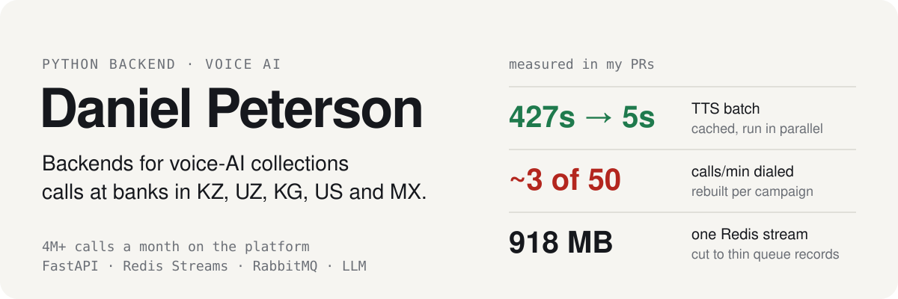
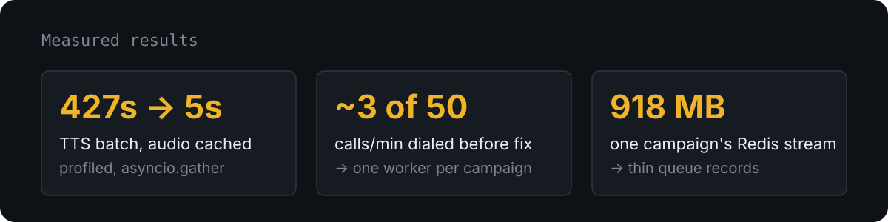

  

Senior backend developer at **CyberNet AI** (Almaty). Our voice-AI platform runs outbound collections calls for banks
in Kazakhstan, Uzbekistan and Kyrgyzstan and for government hotlines. I'm the top contributor in all 8 services
of its FastAPI backend, with 560+ merged PRs since 2024.

  

### What I build

- **Event-driven services:** RabbitMQ / FastStream RPC, a distributed call dispatcher on Redis Streams
  (consumer groups, rate limiting, retries, cross-instance dedup)
- **LLM in production calls:** RASA ↔ LLM dual-flow routing, OpenAI and self-hosted vLLM, RAG knowledge bases used during calls
- **Multi-tenant auth:** JWT with Redis, per-firm RBAC, built to banking-client security requirements
- **Operations:** Docker, Kubernetes/Helm, GitHub Actions, Grafana/Loki

### How I work

Claude Code and spec-driven development (OpenSpec, Gherkin) every day. I own the spec, the architecture and the review,
and agents write most of the code. More than half of my commits in autumn 2026 were co-authored with Claude.

`Python` `FastAPI` `SQLAlchemy` `Pydantic` `Celery` `TaskIQ` `PostgreSQL` `Redis` `RabbitMQ` `Docker` `Kubernetes`
